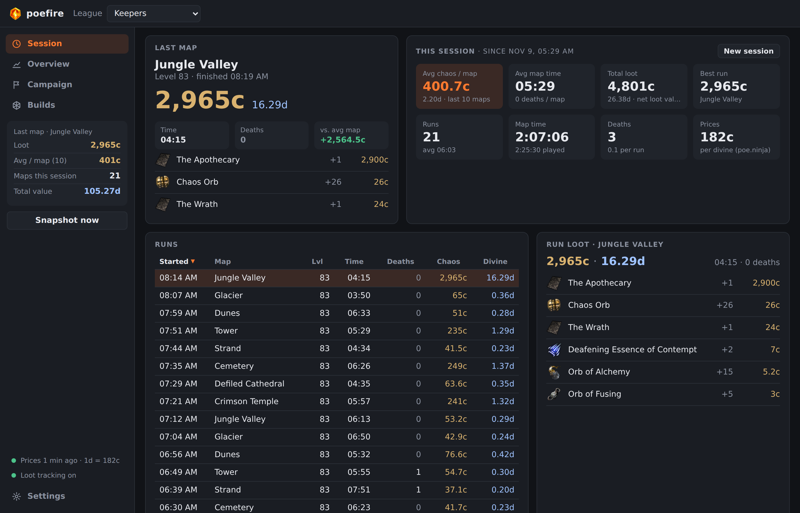
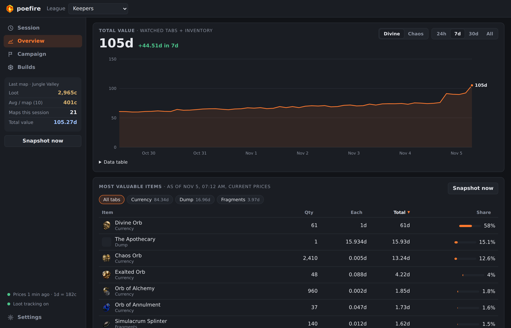
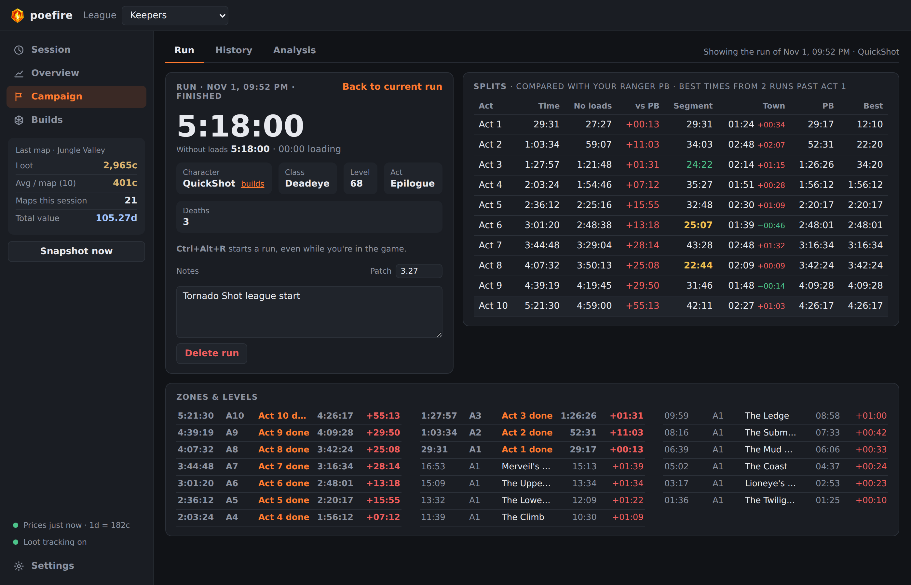
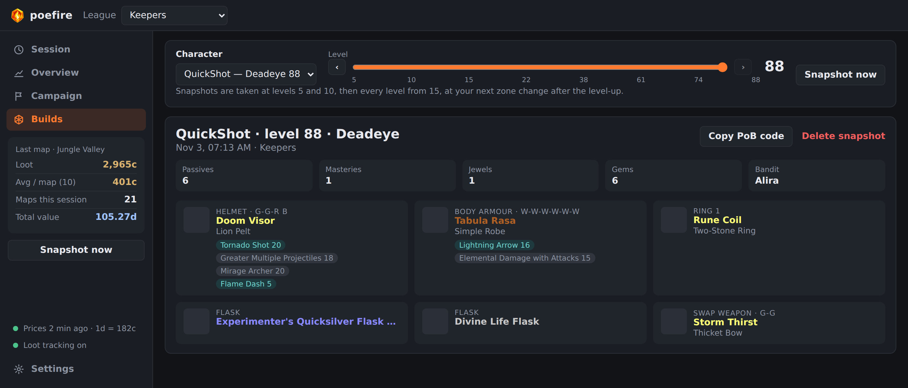
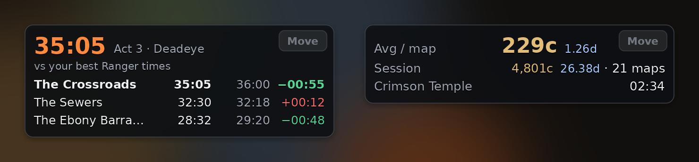

  

<h1 align="center">poefire</h1>

  <b>A farming and campaign tracker for Path of Exile.</b> 
  See what every map earns, time your campaign runs, and keep your build at every level.

  <a href="https://github.com/trigun0x2/poefire/releases/latest"><b>Download for Windows</b></a>
  ·
  <a href="#getting-started">Getting started</a>
  ·
  <a href="#faq">FAQ</a>

## Hi from xyzCat
Hi I’m the dev. I built this because I wanted live updates on my network without paying a third party. That evolved to a bunch of features I also wanted for my own POE journey.

Yes, this heavily vibe coded. yes I do review and test myself, if you’re scared of security issues, please do review the code yourself. 

Regardless, thanks for taking a view and feel free to check out the AI summary on features!

## What it does

- **Loot per map.** When you return to your hideout, poefire sees what the map dropped and
  prices it with poe.ninja: chaos per map, average map time, your best drops, and every
  session's totals.
- **Stash value over time.** A chart of what your stash is worth, and its most valuable items.
- **Campaign timer.** Splits for every act and zone, load-free time, your PB and best times per
  class, your top 3 runs, and notes for each run.
- **Build snapshots.** Your gear, gems and passives at every level, each copyable as a
  Path of Building code.
- **In-game overlay.** Your splits during the campaign, or your chaos per map while mapping,
  shown on top of the game.

**Safe to use.** poefire reads the game's log file (`Client.txt`) and your account's stash
through the Path of Exile website, the same data you see in your browser. It never reads the
game's memory, never touches network traffic and never sends input to the game.

## Getting started

### 1. Install

1. Download `poefire-<version>-windows-x64.zip` from the
   [latest release](https://github.com/trigun0x2/poefire/releases/latest).
2. Unzip it into a folder of your own, for example `%LOCALAPPDATA%\Programs\poefire`
   (not Program Files, so poefire can update itself).
3. Run **poefire.exe**.

Windows may warn that the app is from an unknown publisher: click **More info** →
**Run anyway**. poefire updates itself from then on.

### 2. Point it at the game

Open **Settings**. poefire finds `Client.txt` on its own for standard and Steam installs.
If you installed the game somewhere else, paste the game folder under **Game log**.

That's enough for map times and the campaign timer.

### 3. Connect your account (for loot)

To see what your maps drop, poefire needs to read your stash:

1. Log in on [pathofexile.com](https://www.pathofexile.com) in your browser.
2. Copy the `POESESSID` cookie (press F12 → **Application** or **Storage** → **Cookies**).
3. In poefire's **Settings**, enter your account name (with the `#1234`), paste the cookie and
   click **Check connection**.
4. Pick your league, your character, and the stash tabs your loot goes into.

Your cookie stays on your PC and is never shown or logged. Treat it like a password: anyone
who has it can act as you on the website.

### 4. Play

Run maps as usual. Each time you're back in the hideout, the map's loot and value show up on
the **Session** page. Click **New session** to start counting from zero.

## A tour

### Overview: your stash over time

### Campaign: splits, PBs and top runs

Press **Ctrl+Alt+R** in game (or **Start new run**) and play. The timer splits on every zone
and act from the game's log, and leaves out loading screens. Each run is compared with your
best run of the same class. Press the hotkey again to pause.

### Builds: every level, as a PoB code

Pick a character and drag the slider to see its gear and gems at that level.
**Copy PoB code** copies that build; paste it into Path of Building's
*Import from code*.

### In-game overlay

A small panel over the game: your last areas against your best times during the campaign, or
your chaos per map while mapping. Set the game to **Windowed** or **Windowed Fullscreen**.

- **Ctrl+Alt+O** shows or hides it.
- **Move** (or **Ctrl+Alt+L**) lets you drag it; **Lock** puts it back.
- Clicks go through it to the game.

## FAQ

**Is this allowed?** poefire only reads files and website data that are yours: the game's log
and your own stash and characters. It doesn't read game memory, inspect network traffic, or
press keys for you.

**My maps show no loot.** Check that loot tracking is on (bottom left of the window), and that
you've picked every stash tab your loot goes into in Settings. Loot is counted when you're
back in the hideout, not while you're in the map.

**The campaign timer doesn't split.** The game has to be set to **English**: poefire reads the
game's English log messages. Also check that Settings shows the right `Client.txt`.

**My POESESSID stopped working.** Logging out of the website ends it. Copy a new one into
Settings.

**Something else is wrong.** Go to Settings → **Diagnostics** → **Save debug report** and send
the `.zip` it creates (it never contains your cookie, chat or whispers). Turning on
**Verbose logging** first, then reproducing the problem, makes the report more useful.

## More

- [Reference](docs/reference.md): every feature and setting in detail, the config file and
  the command line.
- [Development](docs/development.md): running from source, how it works, and releases.
